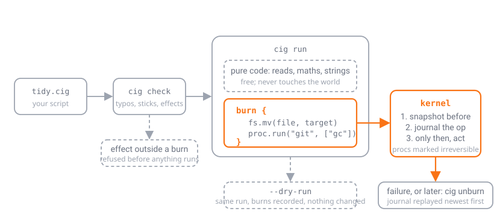

# Burns: effects, modes, the journal and rollback

<p align="center"></p>

The runtime is split into a language, which is pure, and a kernel, which owns
every side effect. This document is the contract for the kernel. The words,
with the manual's name attached (all of them in [LEXICON.md](LEXICON.md)):
*the kernel* (the effect executor, the one piece of code allowed to touch the
world), *a snapshot* (a before-image: a copy taken before the op that will
change it), *the journal* (a write-ahead log: written before each op, so a
kill mid-burn still leaves a record), *newest first* (the order rollback
replays it), *reversible* (the kernel did it itself and has the snapshot to
prove it) and *irreversible* (something the kernel could not watch, and the
plan says so out loud).

## Effects

Every standard-library function declares one effect:

| effect | examples | needs a burn |
|---|---|---|
| pure | `len`, `json.parse`, `text.replace`, all methods | no |
| read | `fs.read_text`, `fs.glob`, `env.get`, `time.now_ms`, `hash.sha256_file` | no |
| write | `fs.write_text`, `fs.rm`, `fs.mv`, `json.save`, `csv.write` | yes |
| proc | `proc.run` | yes |
| env | `env.set`, `env.unset` | yes |

Reads are free because a dry run has to be able to look at the world to decide
what it would do. Writes, processes and environment changes are the world
changing, and they are only allowed inside a `burn { }` block.

The rule is enforced twice. `cig check` (which `cig run` performs first) walks
the script and refuses any effectful call that is syntactically outside a burn
at the top level, and warns about one inside a function body. At run time every
effectful call asks the kernel for permission, and the kernel refuses unless a
burn block is active on the call stack. A function called from inside a burn
may burn.

## Modes

| mode | effectful calls | run record |
|---|---|---|
| `cig run` | executed after being journaled | `~/.cigscript/runs/<id>/` |
| `cig run --dry-run` | simulated, collected into a plan printed at the end; reads see the pretend writes through the ghost filesystem | none |
| `cig check`, `cig eval`, `cig repl` | `check` never executes; `eval` and `repl` behave like `run` without a run directory | none |

Inside `burn unlit { }` every effectful call is simulated whatever the mode,
and the call is recorded as an *intent* rather than a plan entry. Intents are
printed after the run and saved to `intents.jsonl` in the run directory.

A simulated call returns a plausible value so the script can continue:
`fs.write_text` returns the byte count, `proc.run` returns
`{code: 0, out: "", err: "", simulated: true, ...}`.

**The ghost filesystem.** In a dry-run the pretend writes live in memory (an
overlay; a shadow filesystem), and every read consults it before the disk:
`fs.read_text`, `fs.read_lines`, `fs.exists`, `fs.is_file`, `fs.is_dir`,
`fs.size`, `fs.modified_ms`, `fs.list`, `fs.glob`, `json.load`, `csv.read`
and `hash.sha256_file`. A step that reads what an earlier step wrote works in
the dry-run exactly as it will for real; a simulated `fs.rm` or `fs.mv`
leaves a tombstone, so a later read of that path is `E520` ("removed earlier
in this dry-run by op 3 (delete notes.txt)") rather than a misleading
not-found, and a simulated `fs.cp`, `fs.mv` or `fs.rm` of a path that exists
nowhere fails in the plan the way it would fail for real. What the ghost
cannot see is what a hop would have produced: `proc.run` is simulated as an
empty success, so a step that reads a program's output file will not find it
in a dry-run. `burn unlit` never enters the ghost, in any mode: rehearsal
changes nothing, not even a pretend disk.

## The journal

Before an executed op touches the disk, the kernel writes a journal entry with
the state of every path the op will change:

| op | recorded before-state |
|---|---|
| write, append | the path: absent, a file (copied to a snapshot with its SHA-256), or a symlink (its target); if the path is a symlink, also the place the bytes land |
| delete, mkdir | the path: absent, a file, a directory (copied as a tree, links kept as links), or a symlink |
| copy | the destination, as for a write |
| move | the source as "moved to", and the destination |
| proc, env | nothing; these are marked irreversible |

A symlink is always recorded as a link, whatever it points at and whether or
not the target exists, and it is restored as a link. Writing through a link
changes the file it points at, so both the link and that file are recorded.

The journal is `journal.jsonl`, one entry per line. Snapshots live in
`snapshots/` next to it. A last line cut short by a crash mid-append does
not spoil the rest: `cig unburn` loads the entries before it, says the
journal was cut, and restores them. An op the operating system refused
before anything changed (a rename into its own subdirectory) is marked
undone with the same kind of marker, so rollback never "moves back" a file
that never left. A path that is not a file, a directory or a link (a named
pipe, a socket, a device) cannot be snapshotted and the op is refused
(`E702`) rather than hung on. If the kernel cannot journal an op (disk full,
permissions), the op is refused and nothing is changed.

**Durability.** The journal is write-ahead: the snapshot is copied and synced
to disk, the snapshot directory is synced, then the entry is appended and
synced, and only then does the effect happen. A process killed at any point,
or a machine that loses power, leaves a journal that `cig unburn` can replay.
The cost is measured, not guessed: 500 small `fs.write_text` burns in one run
on an ext4 NVMe laptop take about 0.48 s (roughly 1 ms per op), against
0.02 s in 1.0.0, which flushed but never synced. Reads, dry runs and pure
code pay nothing.

Directory deletes snapshot the whole tree, so deleting a large directory costs
a copy of it. Moves cost nothing: rollback moves the file back.

### Durability, by platform

The journal is write-ahead: the snapshot and the entry are flushed before the
effect happens, so a crash between them leaves a record that `cig unburn`
can act on. What "flushed" means is the platform's:

- **Linux and the BSDs:** `fsync` on the snapshot, `fdatasync` on the
  appended entry, `fsync` on the directory that gained the file.
- **macOS:** `fsync` stops at the drive's cache; every flush here is
  `F_FULLFSYNC` (what the standard library's `sync_all` already is on Apple
  targets), which asks the drive to write it out, with `fsync` as the
  fallback on a filesystem that refuses it.
- **Windows:** `FlushFileBuffers` on the snapshot and the entry; the
  directory is flushed through a handle opened with backup semantics where
  NTFS allows it, and left to the filesystem's own journal where it does not.

## Rollback

Rollback replays the journal newest entry first. For each recorded before-state:

- *absent* → the path is removed if it now exists;
- *file* → the snapshot is copied to a staging file beside the path and swapped
  in, so a failure half-way leaves what is there untouched;
- *directory* → the snapshot tree is staged beside the path and swapped in;
- *symlink* → a link to the recorded target is recreated;
- *moved to X* → X is renamed back to the original path.

Irreversible ops (processes, environment changes) are listed under "cannot
undo" so nothing is hidden. Rollback happens automatically when a `cig run`
fails with an uncaught error (disable with `--no-rollback`), and on demand with
`cig unburn <id>`, which works on a run that finished successfully too. The run
record's status becomes `rolled_back` or `unburned`.

`cig unburn` checks before it touches anything. Every snapshot the journal
needs must exist and match its recorded SHA-256, and every moved file must
still be where the run put it (or be put back by a later entry's own
rollback). If anything is missing, the whole rollback is refused with `E703`
and nothing is restored; `--dry-run` lists each problem, and `--force`
restores what can be restored and reports the rest.

`cig unburn` is idempotent: a run that was rolled back already is refused with
`E705`, because restoring the old snapshots a second time would overwrite
whatever happened since. `--force` overrides that too, deliberately. A
rollback that left some restores failed is the exception: a plain
`cig unburn <id>` retries those alone and leaves what was put back as it is.

**What a rollback displaces is kept.** A hop's write set was observed, not
performed, so the kernel cannot tell the hop's bytes from a save made while
the hop ran. For a hop entry, a file the rollback removes or rewrites is
moved into the tin first, the report line says `its bytes went to the tin`,
`cig runs <id>` lists them under `took`, and `cig unburn <id> --give-back`
puts them back, moving what is there now into the tin in turn, so the step
can be reversed again; `--give-back --dry-run` lists what it would put back
and what is there now, and a path changed since the rollback is refused
without `--force` (`E704`). A directory a hop made is removed only when it is
empty: what was put in it since stays, and so does it. A file the hop left
that changed again after the hop ended is left alone, listed with the
`--force` that restores over it. `cig unburn` holds the pack's lock while
it works, as a run does (`E759` for a run that is using it).

**Interrupted runs.** A run whose process died mid-burn is left with the
status `running` and no totals. `cig runs` recognises it (the pid is gone,
the journal is intact), shows it as `interrupted` with its burn count taken
from the journal, and `cig doctor` reports it with `E706` and, under `--fix`,
offers `cig unburn <id>`.


**A file another program holds open (Windows).** A restore stages the
before-image beside the path and renames it into place, which Windows
refuses while another program holds the file without delete sharing (an
editor, an antivirus scanner, an indexer). The swap is retried for about a
second and a half, then the content is written back in place through a
handle the other program's sharing does allow, and the restore line says
`in place: another program held it open`. When even that is refused, the
run stays `rollback_incomplete` and the line says to close the program,
after which `cig unburn <run>` finishes the job.
## The pack, hops, and compensations

A **pack** (`pack { "./build" }`, `LANGUAGE.md`) is the declared scope: the
kernel refuses any native write outside its roots (`E751`; the checker
catches literal paths first, `E750`) and prints the pack in the plan header.
Paths are resolved before they are judged: a symlink inside the pack that
points outside is outside, and the refusal says where the write would land.
The same holds for a hop: a link inside the pack that leads outside it is a
door, not a part of the pack, so nothing behind it is walked or journaled,
a write through it is reported as outside the pack (`E752`), and a rollback
never removes a path whose real place is outside the pack. An empty root
is refused (`E755`): it would have meant the whole working directory.
A **hop** inside a pack is *observed*: the pack's files (mtime, size,
mode), directories (mode) and links (target, and what the link leads to)
are listed before the child runs and again after, and the difference is
journaled as the hop's write set: files the child created are reversible
(`hop created`, rollback removes them), files it modified or deleted are
irreversible with the detail (`hop modified`, `hop deleted`) unless the tin
kept them, a directory it deleted or replaced with a file is made again on
rollback (`(directory)`), and changes in the child's working directory
outside the pack are reported as `E752`. The scan skips `.git`,
`node_modules`, `target` and `.cigscript`, never hashes content, reads the
tree on every core into a compact sorted list (about 60 bytes an entry, so a
million entries is a laptop's business), reuses the scan before the hop for
every directory whose modification time has not moved, and stops only at
`watch_cap` entries (five million, a memory guard): past the cap it warns up
front, journals nothing as created and asks the disk before calling a file
deleted, so a rollback never removes a file that existed before the run. One run at a
time holds a pack: a second run on the same or an overlapping pack is
refused with `E759` while the first runs, because hop watching would read
its writes as the hop's.

A **compensation** is the other half. `burn (s) { ... } unburn { ... }`
journals the `unburn` block's source and the state map `s` when the block
completes (`Op::Compensate`, reversible: it *is* the reversal), and only
then stamps the block's irreversible ops `compensated`, in the journal as
on disk. Rollback,
here or in `cig unburn` later, runs each compensation at its place in the
newest-first order, in a fresh interpreter with effects allowed and nothing
journaled. Hops inside such a block are labelled `compensated` in the plan,
the journal and the rollback report, never `irreversible`; a block that
fails half-way records no compensation, so its hops stay honestly
irreversible. No pack reverses `git push`; that is what the compensation is
for, and the pack and the compensation are two halves of one feature. A
hop can supply the compensation itself through the burn protocol
([PROTOCOL.md](PROTOCOL.md)): a `compensate` line in `CIG_JOURNAL` is
journaled like a block's `unburn` and runs the same way, as a command.

## Chains

A chain (`docs/CHAINS.md`) adds nothing to this model and needs nothing from
it: its steps burn like any code, so `cig light --dry-run` plans every step,
a failed chain rolls back everything its earlier steps burned, and
`cig unburn` reverses a chain that finished. The chain report records timing
per step; the journal records the effects.

## Run records

```
~/.cigscript/runs/20260926T021500-3fa9c1/
  run.json        script, its SHA-256, args, cwd, pid, timings, status, burn counts, the failing diagnostic
  journal.jsonl   executed ops with before-states; compensations; `undone` markers left by a retry
  snapshots/      copies of files and trees as they were before each op
  after.json      what the run left behind, for the changed-since check on unburn
  intents.jsonl   unlit burns (only when there were any)
```

Beside `runs/`, the state directory holds `crashes/` (crash reports, yours
until you send them), `reports/` (`cig report <run>` bundles), `humidor/`
(every other version of cig kept for pinned scripts and old journals, one
directory per version with `index.json` beside them; see `cig versions`),
`tin/` (below) and `update-check.json`.

## The tin

`~/.cigscript/tin/objects/<sha256>` holds the before-bytes of files a hop
may change, outside the project where `git clean` or a task gone wrong
cannot reach them. A hop with `touches` has every existing file under its
globs stashed there before it runs, one object per distinct content, so a
formatter that changes three lines of a file stores that file about once
and fifty runs of the same chain store it once. On rollback a modified or
deleted file comes back from its object, which is re-hashed against its
name first: a corrupt object is refused, never written.

**Chunks and recipes.** A file of 64 KiB or more is not one object but a
*recipe* (`tin/recipes/<sha256 of the file>`): the ordered list of its
chunks, each an object named by its own hash, with the hash and size of
the whole. The chunks are content-defined (FastCDC, 16 KiB at least, 64 KiB
on average, 256 KiB at most), so their boundaries depend on the bytes and
not on offsets: a one-byte change in a 200 MB lockfile stores the chunk it
landed in, an insert at the start moves one boundary, and fifty runs that
each change the file a little cost a tin a small multiple of what changed.
A restore streams the chunks into a staging file beside the destination,
checking each against its name and the whole against the hash the journal
recorded, and a missing or corrupt chunk refuses the restore before
anything at the path is touched. `cig tin` reports the bytes stored next to
the bytes the kept files would take written out, so the saving is visible;
`cig tin verify` checks every recipe names chunks the tin holds; `gc` keeps
every chunk a live recipe names. Smaller files cost exactly what they did
before, and a large file a 1.4 cig kept whole restores as it always did.
Measured in [FINDINGS.md](FINDINGS.md): twenty one-byte edits of a 200 MB
file cost the tin 202 MB, where 1.4 stored 200 MB a run.

**Sealed.** A tin that is on for a whole project would keep every old
`.env`, private key and kubeconfig it ever saw in the clear, for as long as
a run refers to it. So a secret is sealed: encrypted with
XChaCha20-Poly1305 in the STREAM construction (the `chacha20poly1305`
crate; nothing home-made), a megabyte a segment, every segment
authenticated and the last one marked, so a byte flipped, a tail cut off or
a different key is refused on read and nothing is written. A sealed object
(`tin/sealed/<random id>`) is named by a random id, bound to that name, and
never shared between files, so two equal secrets do not reveal that they
are equal; the journal keeps the plaintext's hash and size, so the bytes
are checked on the way back whatever the ciphertext says. What is a secret:
a built-in list of names (`.env` and `.env.*`, `*.pem`, `*.key`, `id_rsa*`,
`id_ed25519*`, `id_ecdsa*`, `id_dsa*`, `*.p12`, `*.pfx`, `credentials*`,
`*secret*`, `.npmrc`, `.pypirc`, `kubeconfig`, `*.kdbx`, `.netrc`,
`.git-credentials`, `*.ppk`, `*.jks`, `*.keystore`), whatever a pack root's
`.cigseal` lists (one glob per line, like `.cigignore`, applying to the tree
below it), a hop's `touches_sealed: ["data/*.db"]` (its files are kept, and
kept sealed), and a native write that says so,
`fs.write_text(p, t, {sensitive: true})`. The `seal` setting is `secrets`
by default, `all` seals everything the tin keeps, `never` turns it off. The
run directory's own snapshots of secrets are sealed the same way
(`<name>.cig-sealed`, the mode in the journal), a secret inside a tree
snapshot too, and what a rollback displaces from a sealed path stays
sealed. The key is 32 random bytes made on first use and kept in the OS
keyring (Secret Service on Linux and the BSDs, Keychain on macOS, Credential
Manager on Windows) under `cigscript` / `tin-seal`; where no keyring
answers within five seconds, in `~/.cigscript/tin/seal.key`, readable by
its owner alone, and a note says so once (`seal_key = file` makes the file
the rule, and tests use it). The plan says `(sealed)` and counts sealed
files in a hop's `touches` line; `cig runs <id>` labels the entry
`(sealed)`; `cig tin` counts sealed objects apart; `cig tin verify` opens
every one with the key (`--quick` checks the shape alone); and when the key
is gone (a new machine, a wiped keyring), a restore refuses naming the
file, and `cig tin gc --sealed-orphans` clears what nothing can open.

**Git blob reuse.** Most files a hop touches in a git project are tracked
and unchanged since the last commit, and git already holds their bytes in
`.git/objects`. Such a file (tracked, and clean against the index: the
bytes on disk hash to the blob the index names, by git's own blob hash) is
not copied into the tin: the journal records the repository, the blob and
our SHA-256 (`(git)` in the record), and a restore reads the blob back
through `git cat-file`, checks it against that hash, and refuses other
bytes the way a corrupt tin object is refused. A blob reachable only from a
commit that is later rebased away could be collected by `git gc`, so the
run pins every blob it refers to under `refs/cig/runs/<run id>`, one tree
naming them all, until `cig runs --prune` drops the record and the pin with
it (`git-pins.txt` in the run directory names the repositories). That is
the choice over falling back to a copy when the blob is unreachable from
`HEAD`: reachability changes after the fact, a pin does not. A dirty or
untracked file goes to the tin as before, so does every file in a
repository the run cannot pin in, and git is only ever read, the pin
aside: nothing writes to the index or the working tree. `cig runs <id>
--verify` asks git for each blob's presence and size; a blob git has lost
is refused with the reason, naming the repository and the pin. The file's own mode
and modification time travel in the journal and are put back with the
bytes, so a `chmod` by the hop is undone and `make` sees the time it saw
before. A symbolic link is kept as a link: its target is all there is, the
journal holds it itself (`(link kept)` in the record), and a link the hop
retargeted, replaced or deleted comes back as the link it was, whether or
not `touches` named it. The tin also holds what a rollback displaced (the
hop's own output, or a save made while it ran) until `--give-back` or `gc`.
`cig tin` says what the tin holds, `cig tin verify` re-hashes every object,
and `cig tin gc` removes the objects no run in the history refers to
(`cig runs --prune N` frees more). An object is named by the hash of the
copy as it was written, so a file changing while it was stashed cannot
leave an object that lies about its name, and one already there is reused
only when it still hashes to its name. A hop lists the objects it stashed
in its run directory (`tin.pending`) before any exists under its name, so
a `gc` during the hop keeps them.

A `.cigignore` at a pack root (one glob per line, `#` comments) lists what
hop watching and the tin never look into; `.git`, `node_modules`, `target`,
`.venv`, `venv`, `__pycache__`, `.gradle`, `.terraform` and `.cigscript` are
skipped everywhere. Those trees are rebuilt, not restored.

Every record says what shape it is in: `run.json` carries `"format": 1`,
`after.json` `"format": 2`, and the first line of `journal.jsonl` is
`{"format":2,"prev":"…"}` (a marker, so a cig from before formats reads
past it). A newer cig reads every older format and never rewrites an old
record in place; a format it does not know is refused by its number with
the version that wrote it (`E808`), and `cig unburn` hands the run to that
version from the humidor instead of guessing.

**The hash chain.** From format 2 (1.5.0) every line of the journal carries
`prev`: the SHA-256 of the line before it exactly as written, and the first
line that of the run's id. When the record is saved, `run.json` keeps the
hash of the last line (`journal_head`). `cig runs <id> --verify` walks the
chain and reports the first line that does not fit (edited, removed or
reordered), compares the head with the record (lines added or removed
since), and checks every snapshot and tin object a rollback would need
against its recorded hash. `cig unburn` walks the chain before it changes
anything and refuses a broken one with `E760`; `--force` restores from the
journal as it is, knowingly. A format 1 journal has no chain, is read as it
always was, and the markers an unburn appends to it carry no `prev`. This
is tamper evidence, not secrecy: anyone who can write the journal can
recompute the chain, unless the head is kept somewhere they cannot write
(a note of `journal_head` elsewhere makes the record checkable against it).

A run's status is one of `running`, `ok`, `failed`, `rolled_back`,
`unburned`, `unburn_failed`, or `interrupted` (derived when a `running`
record's process no longer exists). Burn counts shown by `cig runs` come from
the journal, which is authoritative even when the run never wrote its totals.

Run ids sort chronologically (UTC). `cig runs` lists them, `cig runs <id>`
shows one with its journal, `cig runs --prune N` keeps the newest N, and
`CIGSCRIPT_HOME` relocates the whole state directory (tests use this to stay
isolated).

## The parcel

A run's undo lives on the machine that ran it: the record under
`~/.cigscript/runs/<id>/`, its snapshots, and the tin objects it refers to.
`cig parcel <run>` writes them as one file, `<run>.cigparcel` (a gzipped
tar): `run/` with the record, the journal and the after-state and every
snapshot; `tin/` with every object, recipe, chunk and sealed object the
journal refers to, and nothing another run holds; `git/` with the bytes of
every blob git held for the run, carried whole so the other machine needs
no repository; and `manifest.json` naming each file's SHA-256, the cig
that wrote it, the pack's roots (each with a name, its last component) and
the working directory. `cig unparcel <file>` checks every file against the
manifest before it writes anything, and a byte changed refuses the whole
parcel (`E762`); every root must be mapped to a place here (`--root
build=/srv/app/build`; `--show` lists them, `--cwd` sets the working
directory when it cannot be told from the roots, which it can when a root
sits under it by the same relative path); sealed objects this machine's
key does not open are refused unless `--allow-sealed-missing`. The objects
go into the tin (a content-named one already there is kept when it hashes
to its name), the run among the runs, and its record says where it came
from and how its paths map (`imported`). The journal itself is never
rewritten, so its chain still verifies; the record's map is applied as it
is read. From then on `cig runs <id>` lists it as imported and
`cig unburn <id>` works here, with the usual drift check (`E704`) against
this machine's files.

## What it can't undo, and says so

The irreversible label is the honesty guarantee. It is the one thing that
must never be wrong, because the whole model is trusted through it: a plan
that says *reversible* is a promise the kernel can keep, and a plan that says
*irreversible* is the kernel refusing to launder what it cannot watch. Both
are written before the effect and shown in the plan, the run record and the
rollback report ("cannot undo"). What the label covers:

- **No sandbox.** A script can read anything the user can read, and a burn can
  run any program. The kernel makes effects explicit and reversible where it
  performed them itself; it does not confine untrusted code.
- **No rollback of what processes did, unless you say how.** A hop is
  journaled as irreversible; inside a pack the files it created are removed
  on rollback. What it modified or deleted comes back too when the hop said
  it might touch them (`touches: ["src/**"]`): those files' before-bytes
  went to the tin first. The rest is listed; inside a `burn { } unburn { }`
  block the compensation is the undo and the label says `compensated`.
  Prefer `fs.rm`, which the kernel can undo on its own.
- **Cross-run consistency is checked, not guaranteed.** When a run finishes,
  the kernel records what it left behind (`after.json`: the state of every
  path it touched; a file by hash and size, a directory by a fingerprint of
  its entries' names, kinds, sizes and modification times, so a file you
  added to a directory the run created counts as a change and is not swept
  away with it, while an edit that keeps a file's size and puts its time
  back is not seen). `cig unburn` compares
  that with the disk now and refuses
  with `E704` when anything changed since, naming the later run that touched
  the path when there is one, so runs are unburned newest first; `--force`
  restores over the newer content anyway. `cig unburn --dry-run` prints the
  plan with a *changed since* column. A run that predates after-state records
  says "unknown" and is allowed.
- **Snapshots are plain copies**, under your home directory, except for
  secrets, which are sealed (above): a secret-shaped name, a `.cigseal`
  entry or `{sensitive: true}` keeps the before-bytes encrypted at rest. Prune
  the rest with `cig runs --prune` if it holds anything sensitive the list
  did not know. Snapshots keep the full mode (setuid, setgid and sticky bits
  included), and a restored tree keeps the mode of its root.
- **Restores are atomic where they can be.** A file comes back beside its
  destination and is swapped in, so a failure half-way leaves what is there
  untouched; on Unix a file that has other hard links is restored in place
  instead, so every name sees the old bytes. A file the run moved across
  filesystems is copied back the same way, and when a move back fails the
  only copy is kept, never removed. What a rollback could not restore is
  recorded on the run (`rollback_incomplete`; `cig runs <id>` lists the
  failures), a plain `cig unburn <id>` then retries those alone with the
  rest left as it is (`--force` restores everything again), and `cig unburn`
  refuses to start when it could not record itself.
